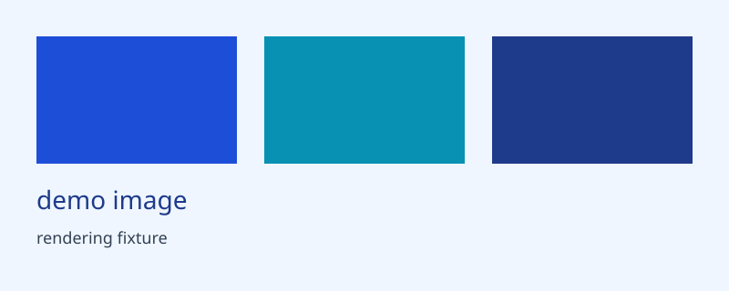

这是一篇草稿，只用来检查主题怎么渲染代码、公式、图和图片。没有个人观点。

## 代码块

下面是一段 Python。复制按钮由主题脚本插到代码块上。

```python
def square(n: int) -> int:
    """Return the square of n."""
    return n * n


if __name__ == "__main__":
    print(square(4))
```

## 公式



行内公式 \(\varphi = \dfrac{1+\sqrt{5}}{2}\)。

独立公式：

$$
\int_{0}^{1} x^{2} \, dx = \frac{1}{3}
$$

## 图


graph TD
  A[Markdown] --> B[Hugo]
  B --> C[HTML]


## 图片


